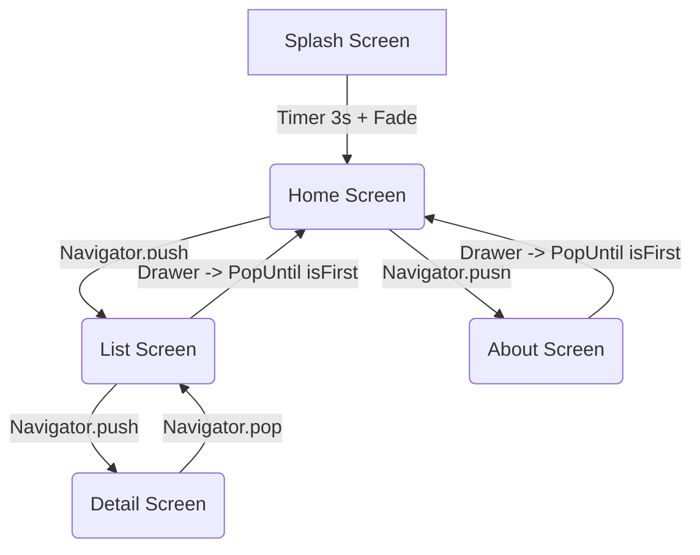

<div align="center">


# 🇵🇰 Explore Pakistan

### A Flutter Travel Guide to the Land of the Pure


&nbsp;&nbsp;&nbsp;


</div>

---

## 📑 Table of Contents

1. [About the Project](#-about-the-project)
2. [Key Features](#-key-features)
3. [App Screenshots](#-app-screenshots)
4. [Tech Stack](#-tech-stack)
5. [Design System & Architecture](#-design-system--architecture)
6. [Advanced Flutter Implementations](#-advanced-flutter-implementations)
7. [Screen-by-Screen Breakdown](#-screen-by-screen-breakdown)
8. [Navigation Flow & State Management](#-navigation-flow--state-management)
9. [Data Models](#-data-models)
10. [Project Structure](#-project-structure)
11. [Assignment Requirements Mapping](#-assignment-requirements-mapping)
12. [Local Setup & Installation](#-local-setup--installation)
13. [Building for Release](#-building-for-release)
14. [Troubleshooting](#-troubleshooting)
15. [Future Enhancements](#-future-enhancements)
16. [Learning Outcomes](#-learning-outcomes)
17. [Author](#-author)
18. [License](#-license)

---

## 📖 About the Project

**Explore Pakistan** is a comprehensive, visually elegant Flutter application developed for **Assignment 2** of the **Mobile Application Development (MAD)** course. It acts as a digital travel guide showcasing the majestic landscapes, historical landmarks, and cultural heritage of Pakistan: from the snow-capped peaks of the Karakoram to the Mughal-era architecture of Lahore.

This project is architected using clean, modular code principles. It implements advanced Flutter UI concepts including **Sliver-based scrolling**, **Hero animations**, **custom navigation routing**, and **responsive layout constraints** so the app looks polished on both mobile devices and wide screens (Web/Tablet).

> 🎯 **Goal:** Demonstrate mastery of core Flutter fundamentals (navigation, lists, grids, animations, theming) while keeping the code reusable, readable and well organised.

---

## ✨ Key Features

| Icon | Feature | Description |
| :---: | :--- | :--- |
| 🌀 | **Animated Splash Screen** | Bouncy logo with elastic scale and fade-in, auto-navigates after 3 seconds. |
| 🏔️ | **Collapsing Home Header** | `SliverAppBar` that shrinks smoothly into a regular AppBar on scroll. |
| 📜 | **Destination List** | 10 curated destinations rendered with an efficient `ListView.builder`. |
| 🦸 | **Hero Transitions** | Destination images "fly" from the list into the detail screen. |
| 🖼️ | **Photo Gallery** | 6-item `GridView.builder` with captions on the About screen. |
| 🧭 | **Smart Drawer** | Custom drawer that clears the navigation stack to avoid memory buildup. |
| 📱 | **Responsive Frame** | Web/Tablet view is constrained to a centered 520 px mobile-style layout. |
| 🛡️ | **Safe Image Loading** | Custom `AssetPhoto` widget with an `errorBuilder` fallback, so no red error screens. |
| 🎨 | **Material 3 Theming** | Centralised design tokens for a consistent forest-green identity. |

---

## 📱 App Screenshots

> 💡 **How to add your screenshots:** Create a folder named `screenshots/` in your repo, drop your images in it, and make sure the file names below match. They will then render automatically.

<div align="center">

| Splash Screen | Home Screen | List Screen | Detail Screen |
| :---: | :---: | :---: | :---: |
|  |  |  |  |
| *Animated launch* | *Sliver header + action cards* | *10 destinations* | *Hero image + info* |

| About Screen | Gallery Grid | Navigation Drawer | Web / Tablet View |
| :---: | :---: | :---: | :---: |
|  |  |  |  |
| *App info* | *6-photo grid* | *Close (✕) button included* | *Centered 520 px frame* |

</div>

---

## 🧰 Tech Stack

<div align="center">


</div>

| Technology | Logo | Role in the project |
| :--- | :---: | :--- |
| **Flutter 3.x** |  | Cross-platform UI framework |
| **Dart 3.x** |  | Programming language |
| **Material 3** |  | Design language & components |
| **Android Studio** |  | IDE / emulator |
| **VS Code** |  | Code editor |
| **Git & GitHub** |  | Version control & hosting |

**No third-party packages** are required beyond the Flutter SDK itself. Everything is built with core widgets.

---

## 🎨 Design System & Architecture

The application uses a centralized configuration for its design system to ensure absolute UI consistency across all screens. It strictly follows **Material 3** design guidelines.

### 1. Design Tokens (`lib/shared.dart`)

Instead of hardcoding colors, the app relies on globally defined constants:

| Swatch | Token | Hex Code | Purpose |
| :---: | :--- | :--- | :--- |
|  | `kPrimary` | `#34483A` | Primary forest green used for AppBars, buttons, and active states. |
|  | `kDark` | `#26352C` | Darker green used for text and gradient transitions. |
|  | `kBackground` | `#F4F6F4` | Soft off-white background for main screens. |
|  | `kSurround` | `#E8ECE8` | Grey surround used by `PageFrame` for Web/Tablet views. |

**Usage example:**

```dart
const Color kPrimary    = Color(0xFF34483A);
const Color kDark       = Color(0xFF26352C);
const Color kBackground = Color(0xFFF4F6F4);
const Color kSurround   = Color(0xFFE8ECE8);

AppBar(backgroundColor: kPrimary, foregroundColor: Colors.white);
```

### 2. Responsive Layout (`lib/page_frame.dart`)

Mobile apps usually stretch awkwardly on web browsers. To fix this, the `PageFrame` widget wraps the app in a `ConstrainedBox` with a `maxWidth: 520`. This forces the app to look like a centered mobile phone screen on larger displays, keeping the UI beautiful.

```text
┌──────────────────────────────────────────────┐
│               Browser window                 │
│   ┌────────────┬──────────────┬───────────┐  │
│   │ kSurround  │ App (≤520px) │ kSurround │  │
│   │  (grey)    │   centered   │  (grey)   │  │
│   └────────────┴──────────────┴───────────┘  │
└──────────────────────────────────────────────┘
```

### 3. Reusable Asset Management (`AssetPhoto` Widget)

Instead of using standard `Image.asset()` everywhere, a custom `AssetPhoto` widget was created in `shared.dart`. It includes an `errorBuilder` that gracefully renders a grey placeholder icon if an image is missing, preventing the dreaded "red screen of death." It also enforces `FilterQuality.high` for sharp rendering.

**Benefits:**
- ✅ One place to change image behaviour (fit, quality, fallback)
- ✅ No crashes when an asset path has a typo
- ✅ Cleaner screen code, with no repeated `errorBuilder` blocks

---

## 🚀 Advanced Flutter Implementations

Here is a deep dive into the specific Flutter techniques used in the codebase:

### 🪄 1. Sliver-Based Scrolling (`CustomScrollView`)

Instead of a standard `Scaffold(appBar:...)`, the Home and Detail screens use a `CustomScrollView`. This allows the `SliverAppBar` to smoothly shrink and collapse into a standard AppBar as the user scrolls up.

| Sliver | Purpose |
| :--- | :--- |
| `SliverAppBar` | Expandable header image that collapses on scroll |
| `SliverToBoxAdapter` | Embeds regular widgets (text, cards) in the scroll view |
| `SliverList` | Lazy list of content inside the same scroll view |

### ✨ 2. Fluid Animations

- **Splash Screen:** Uses an `AnimationController` with `Curves.elasticOut` to create a bouncy scale-up effect for the logo, combined with an `Interval` fade-in.
- **Smooth Routing:** The transition from Splash to Home uses a custom `PageRouteBuilder` with a 600 ms `FadeTransition` instead of the default jarring jump.

```dart
Navigator.pushReplacement(
  context,
  PageRouteBuilder(
    transitionDuration: const Duration(milliseconds: 600),
    pageBuilder: (_, __, ___) => const HomeScreen(),
    transitionsBuilder: (_, animation, __, child) =>
        FadeTransition(opacity: animation, child: child),
  ),
);
```

### 🦸‍♂️ 3. Hero Animations

When a user taps a destination in the `ListView`, the image seamlessly "flies" to the Detail Screen. This is achieved by wrapping both images in a `Hero` widget with a shared, unique tag.

```dart
// List screen
Hero(tag: 'dest-${destination.name}', child: AssetPhoto(destination.image));

// Detail screen (same tag!)
Hero(tag: 'dest-${destination.name}', child: AssetPhoto(destination.image));
```

> ⚠️ Each tag must be **unique per destination** and **identical on both screens**, otherwise the animation will not run.

### 🧱 4. Lazy Building with `.builder`

Both `ListView.builder` and `GridView.builder` build items only when they scroll into view, keeping memory usage and frame times low even for larger datasets.

---

## 🖥️ Screen-by-Screen Breakdown

### 1️⃣ Splash Screen (`splash_screen.dart`)
- Full-screen forest-green background
- Logo scales in with `Curves.elasticOut`
- Text fades in using an `Interval`
- A `Timer(Duration(seconds: 3))` triggers navigation to Home

### 2️⃣ Home Screen (`home_screen.dart`)
- `SliverAppBar` with a hero banner image and gradient overlay
- Action cards linking to the **Destinations** and **About** screens
- Custom drawer for quick navigation

### 3️⃣ List Screen (`list_screen.dart`)
- `ListView.builder` with **10 destinations**
- Each card shows image thumbnail, name, location and short description
- Tapping a card pushes the Detail screen with a Hero transition

### 4️⃣ Detail Screen (`detail_screen.dart`)
- Large Hero image in a collapsing `SliverAppBar`
- Full description, region, best season to visit and highlights
- Back button uses `Navigator.pop`

### 5️⃣ About Screen (`about_screen.dart`)
- App information and purpose
- **6-item photo gallery** built with `GridView.builder`
- Each gallery tile has an image and a caption

### 6️⃣ App Drawer (`app_drawer.dart`)
- Shared across all main screens
- Includes a close (✕) button via the `DrawerBackLeading` widget
- Uses stack-clearing logic (see below)

---

## 🧭 Navigation Flow & State Management

The app uses standard `Navigator.push` and `Navigator.pop` combined with a highly optimized custom Drawer. State is kept simple and local (`StatefulWidget` + `setState`), which is ideal for an app of this scope.

### Drawer Routing Logic (`lib/app_drawer.dart`)

The custom drawer handles routing intelligently to prevent the navigation stack from growing infinitely (which wastes memory).

1. User taps a drawer item.
2. `Navigator.pop(context)` closes the drawer.
3. `Navigator.popUntil((route) => route.isFirst)` clears the stack back to the Home screen.
4. `Navigator.push()` opens the new screen.

```dart
void _go(BuildContext context, Widget page) {
  Navigator.pop(context);                              // 1. close drawer
  Navigator.popUntil((route) => route.isFirst);        // 2. back to Home
  Navigator.push(context, MaterialPageRoute(builder: (_) => page)); // 3. open page
}
```

### Navigation Diagram



---

## 🗃️ Data Models

All models live in `lib/shared.dart` so any screen can import them.

| Model | Fields | Used by |
| :--- | :--- | :--- |
| `Destination` | `name`, `location`, `image`, `description` | List & Detail screens |
| `GalleryItem` | `image`, `caption` | About screen grid |

```dart
class Destination {
  final String name;
  final String location;
  final String image;
  final String description;
  const Destination({
    required this.name,
    required this.location,
    required this.image,
    required this.description,
  });
}
```

---

## 📂 Project Structure

The codebase follows a modular, flat folder structure. All shared logic is decoupled from the UI.

```text
explore_pakistan_flutter_Assignment2/
│
├── assets/
│   └── images/               # Local image assets (hunza.jpg, skardu.jpg, etc.)
│
├── screenshots/              # README screenshots (splash.png, home.png, ...)
│
├── lib/
│   ├── main.dart             # Application entry point, theme config, routes.
│   ├── shared.dart           # Global constants, Models (Destination, GalleryItem), AssetPhoto.
│   ├── page_frame.dart       # Responsive constraint (max 520px width).
│   │
│   ├── splash_screen.dart    # Animated launch screen.
│   ├── home_screen.dart      # Landing page (SliverAppBar + Action Cards).
│   ├── list_screen.dart      # Scrollable list of 10 destinations (ListView.builder).
│   ├── detail_screen.dart    # Hero-animated detail view (SliverAppBar).
│   ├── about_screen.dart     # App info + 6-item Photo Gallery (GridView.builder).
│   └── app_drawer.dart       # Shared side navigation menu + DrawerBackLeading widget.
│
├── pubspec.yaml              # Project metadata, dependencies, asset declarations.
└── README.md                 # You are here 🙂
```

### Declaring assets in `pubspec.yaml`

```yaml
flutter:
  uses-material-design: true
  assets:
    - assets/images/
```

---

## 📋 Assignment Requirements Mapping

| Requirement | Status | How It Was Solved |
| :--- | :---: | :--- |
| **1. Splash Screen** | ✅ | Auto-navigates after 3 seconds using a `Timer`. |
| **1. Animation** | ✅ | Logo scales up using `ScaleTransition` and fades using `FadeTransition`. |
| **2. Three Screens** | ✅ | Home, List, and About screens are fully implemented. |
| **2. Navigator.push/pop** | ✅ | Used heavily to open Detail screens and return to the Home screen. |
| **2. Drawer Menu** | ✅ | Custom drawer with a close (✕) button available on all main screens. |
| **3. ListView (10 items)** | ✅ | 10 Pakistani destinations listed using `ListView.builder`. |
| **3. GridView (6 items)** | ✅ | 6 gallery images with captions displayed in the About screen. |
| **Bonus: CustomScrollView** | ✅ | Implemented `SliverAppBar` on both the Home and Detail screens. |
| **Bonus: Hero Animation** | ✅ | Shared tag between List and Detail images. |
| **Bonus: Responsive Web** | ✅ | `PageFrame` constrains width to 520 px on large screens. |

---

## 💻 Local Setup & Installation

### Prerequisites

| Requirement | Version | Check with |
| :--- | :--- | :--- |
| Flutter SDK | 3.x or newer | `flutter --version` |
| Dart SDK | 3.x (bundled with Flutter) | `dart --version` |
| IDE | Android Studio or VS Code | with the Flutter plugin |
| Device | Android emulator, iOS simulator, or Chrome | `flutter devices` |

To run this project locally, ensure you have the [Flutter SDK](https://docs.flutter.dev/get-started/install) installed on your machine.

1. **Clone the repository:**
   ```bash
   git clone https://github.com/Muhammad-Habib783/explore_pakistan_flutter_Assignment2.git
   ```

2. **Navigate into the project:**
   ```bash
   cd explore_pakistan_flutter_Assignment2
   ```

3. **Verify your Flutter installation:**
   ```bash
   flutter doctor
   ```

4. **Fetch dependencies:**
   ```bash
   flutter pub get
   ```

5. **Run the app:**
   ```bash
   flutter run
   ```
   *(You can run this on an Android Emulator, iOS Simulator, or Chrome/Edge for Web.)*

### Run on a specific platform

```bash
flutter run -d chrome      # Web
flutter run -d android     # Android device / emulator
flutter run -d ios         # iOS simulator (macOS only)
```

---

## 📦 Building for Release

| Platform | Command | Output |
| :--- | :--- | :--- |
| Android APK | `flutter build apk --release` | `build/app/outputs/flutter-apk/app-release.apk` |
| Android Bundle | `flutter build appbundle --release` | `build/app/outputs/bundle/release/` |
| Web | `flutter build web --release` | `build/web/` |
| iOS | `flutter build ios --release` | Requires macOS + Xcode |

---

## 🛠️ Troubleshooting

| Problem | Likely cause | Fix |
| :--- | :--- | :--- |
| Images show a grey placeholder icon | Wrong asset path or file name | Check file names in `assets/images/` and the `pubspec.yaml` asset list |
| Assets not found after adding images | Assets not registered | Add `assets/images/` to `pubspec.yaml`, then run `flutter pub get` |
| Hero animation does not play | Tags differ or are duplicated | Use the exact same unique tag on both screens |
| App looks stretched on Chrome | `PageFrame` not wrapping the screen | Wrap screens with `PageFrame` |
| `flutter: command not found` | SDK not on PATH | Add `flutter/bin` to your system PATH |
| Build errors after upgrading Flutter | Stale cache | Run `flutter clean && flutter pub get` |

---

## 🔮 Future Enhancements

- [ ] 🔍 Search & filter destinations by region or season
- [ ] ❤️ Favourites list saved with `shared_preferences`
- [ ] 🗺️ Interactive map using `google_maps_flutter`
- [ ] 🌦️ Live weather for each destination via a weather API
- [ ] 🌙 Dark mode theme
- [ ] 🌐 Urdu / English localisation
- [ ] ☁️ Load destinations from a backend (Firebase / REST API)
- [ ] ✅ Unit and widget tests

---

## 🎓 Learning Outcomes

By building this project, the following Flutter concepts were practised:

- Building **multi-screen apps** with `Navigator`
- Creating **explicit animations** with `AnimationController`, `Curves` and `Interval`
- Using **slivers** for advanced scrolling effects
- Implementing **Hero** shared-element transitions
- Designing a **reusable widget** (`AssetPhoto`) with error handling
- Applying **design tokens** and **Material 3** theming
- Making a mobile app **responsive** on web using `ConstrainedBox`
- Structuring code in a **clean, modular** way

---

## 👨‍💻 Author

<div align="center">


### **Muhammad Habib**

[](https://github.com/Muhammad-Habib783)

*Developed as part of the Mobile Application Development (MAD) Assignment #2.*

</div>

---

## 📄 License

This project is released under the **MIT License**. It is free to use for learning and reference.

---

<div align="center">

### ⭐ If you liked this project, please give it a star! ⭐

Made with 💚 and Flutter in 🇵🇰 Pakistan

</div>